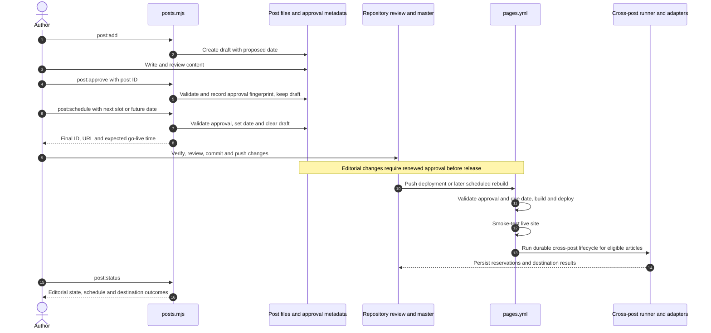

# Publishing workflow: feature brief

Status: shipped and active (PRs #19, #20). These feature documents are historical design records and may mention files since removed (`scripts/linkedin-post.mjs`, `scripts/crosspost-migrate.mjs`, the old ledgers). Operator guidance: [publishing.md](../../publishing.md).

Feature documents: **Brief** · [Design](design.md) · [Plan](plan.md) · [Testing](testing.md).

Repository paths in these documents are relative to the repository root unless stated otherwise.

## Problem

Authoring and destination publishing currently expose separate commands and workflows. Sitemap-based LinkedIn sharing can lose failed shares, existing ledgers are destination-specific, and adding another destination would duplicate lifecycle logic.

## Goal

Provide a seamless **add → approve → schedule** author journey. After reviewed changes reach `master`, the site deploys due articles and automatically submits them to Medium and queues link shares for LinkedIn, with visible outcomes and safe recovery from uncertain submissions.

## User journey

1. **Add:** create and edit a draft using valid site metadata.
2. **Approve:** explicitly approve reviewed content without releasing it.
3. **Schedule:** choose a future UK-local publication slot for approved content.
4. Review, verify, commit and push through normal repository policy.
5. Actions builds/deploys due articles, smoke-tests the live site and runs cross-posting automatically.
6. Inspect editorial, schedule and destination status; reconcile uncertain attempts when necessary.

Approval is a human decision, not automated fact-checking. Editing reviewed content invalidates approval. Commands and exact transition rules are specified in [design](design.md#author-workflow-and-package-scripts).

## Scope

- Author CLI and package script cleanup, approval metadata, scheduling and status.
- Medium initial story creation and LinkedIn feed posts linking to the site.
- One shared committed destination ledger on `master`, with explicit historical baselines.
- One Actions deployment/publishing workflow, including deliberate manual controls.
- Thin destination adapters over shared selection, policy, reservations and recovery.
- Migration, tests, dry-run rollout and explicit activation.

## Out of scope

- Updating or deleting external copies when site articles change.
- Native LinkedIn long-form Articles.
- Automatically publishing existing Medium drafts or duplicating them to make them public.
- OAuth renewal automation.
- A plugin framework, dynamic adapter discovery or generic workflow engine.
- Exactly-once delivery guarantees across external platforms and Git.

## Constraints and safeguards

- Preserve live article URLs and existing publication history.
- No historical LinkedIn spam or silent archive backfill when enabling a destination.
- At most one automatic LinkedIn creation allowance per UTC day; unresolved attempts block further automatic shares.
- Publish from the deployed source snapshot, not newer un-deployed content.
- Persist reservations before external writes so uncertain outcomes cannot become blind retries.
- Honour verification hooks, branch protection and trusted-workflow boundaries.
- Publishing failures remain visible without undoing completed deployment.
- Keep normal authoring separate from advanced recovery and local export utilities.

## End-to-end author journey

## Acceptance criteria

- Normal author journey is add → approve → schedule, followed by reviewed commit/push; no per-destination publishing commands are needed.
- Approval never publishes a draft; scheduling requires current approval and a future date, with clear UK/UTC timing.
- Package scripts mirror authoring stages and separate advanced operations/export from normal publishing.
- Historical articles are not automatically shared to LinkedIn; new destinations cannot silently publish the archive.
- A newly live article is submitted to Medium for public publication and queued for LinkedIn without local commands; returned Medium drafts are reported honestly.
- LinkedIn permits at most one automatic creation allowance per UTC day; unresolved outcomes block further automatic shares.
- Later runs skip recorded successes/reservations and retry only failures known not to have created content.
- Medium drafts are never duplicated to make them public.
- Runner crashes and failed result pushes leave durable review blocks rather than eligible missing state.
- Publishing uses the deployed source snapshot, not newer un-deployed trunk content.
- Publishing failures do not undo an already completed site deployment, but remain visible in Actions.
- Both platforms use one committed state file; a new adapter reuses shared lifecycle and policy without copying orchestration.
- `pages.yml` is the sole Actions publishing workflow; manual controls select destinations/articles without bypassing deployment, state safety or trust guards.

## Delivery and dependencies

Implementation is gated on reviewed historical/approval baselines, working destination credentials and repository rules permitting workflow state commits. See [plan](plan.md) for migration, configuration, verification and activation gates; see [design](design.md) for technical behaviour.
