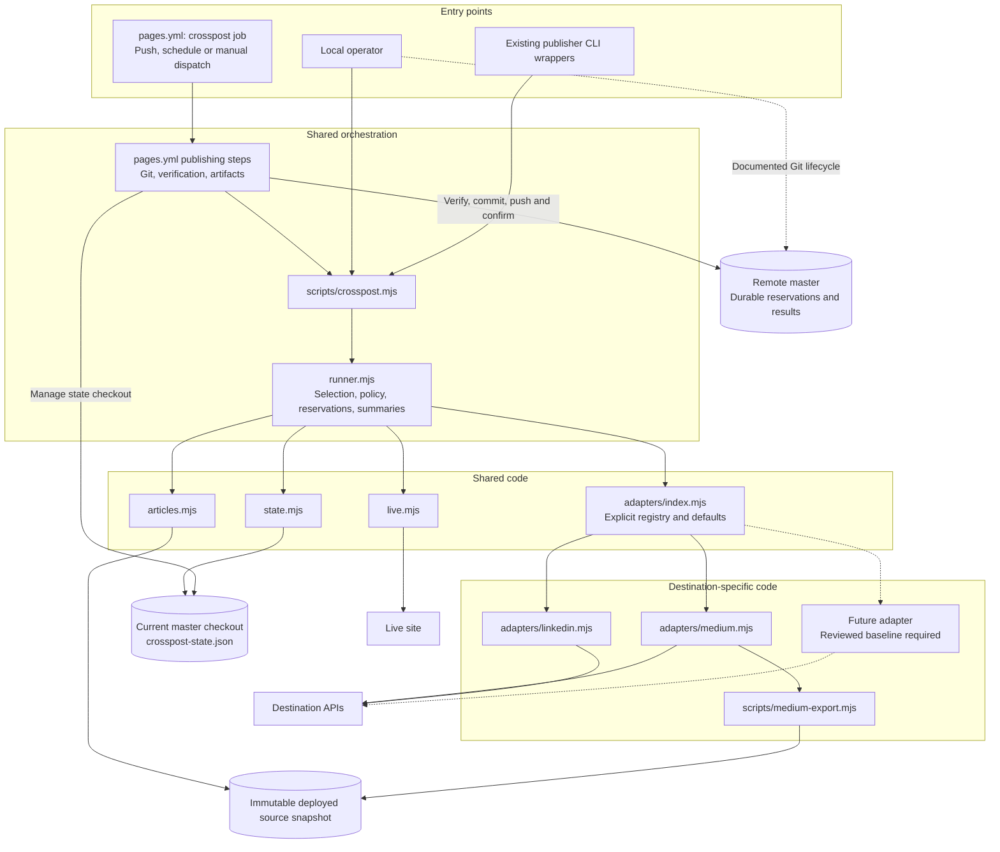
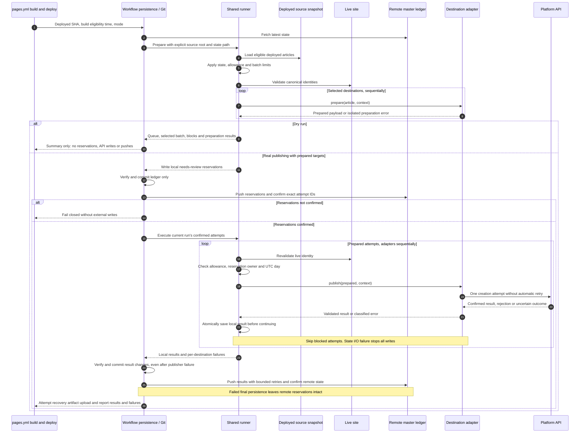
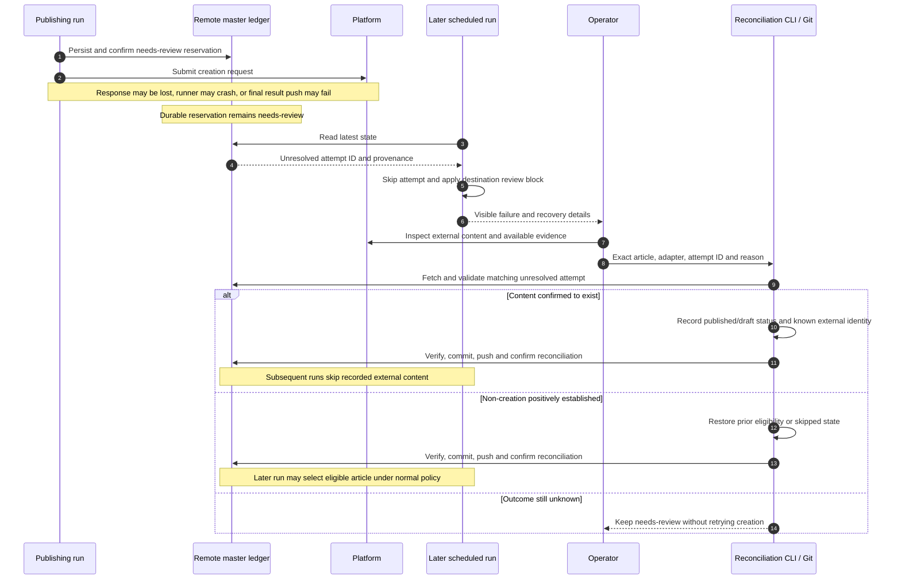

# Publishing workflow: technical design

Status: proposed. No publishing or workflow changes implemented yet.

Feature documents: [Brief](brief.md) · **Design** · [Plan](plan.md).

Repository paths in these documents are relative to the repository root unless stated otherwise.

This document specifies implementation behaviour for the [feature brief](brief.md). Migration, environment setup, verification and rollout live in [plan](plan.md).

Use a small shared runner and destination-specific adapters. Adding a destination should not require copying selection, ledger, retry or persistence logic. Do not build a plugin framework, dynamic discovery or a generic workflow engine.

## Existing components

- `.github/workflows/pages.yml` builds and deploys on `master` pushes, manual runs and three daily schedules.
- Its current LinkedIn step uses `scripts/linkedin-post.mjs` and a pre-deploy sitemap snapshot. Failed shares are not retried on later deployments because the article is no longer new to the sitemap.
- `scripts/linkedin-publish.mjs` selects live articles, publishes link posts and writes `src/data/linkedin-posted.json`.
- `scripts/medium-publish.mjs` uses `scripts/medium-export.mjs` to render content and images, uploads images and creates a story with the site's canonical URL. It writes `src/data/medium-posted.json` and defaults to creating drafts unless `--public` is supplied.
- `.github/workflows/linkedin.yml` provides manual URL-based sharing without duplicate protection.
- Existing Medium ledger entries are recorded as drafts. They must not be recreated automatically.

## Author workflow and package scripts

Normal author workflow is **add → approve → schedule**. Building, deploying and cross-posting follow automatically after reviewed changes reach `master`; authors do not run destination-specific publishing commands.

### Author-facing commands

Use one `scripts/posts.mjs` CLI for authoring transitions, reusing existing `scripts/new-post.mjs`, `scripts/schedule.mjs` and `scripts/lib/posts.mjs` logic rather than copying it.

| Package script | Proposed command | Purpose |
| --- | --- | --- |
| `post:add` | `node scripts/posts.mjs add` | Create a draft with valid taxonomy and a proposed date |
| `post:approve` | `node scripts/posts.mjs approve` | Record explicit human approval of the reviewed content without making it publishable |
| `post:schedule` | `node scripts/posts.mjs schedule` | Assign a future UK-local publication slot and make an approved post eligible at that time |
| `post:status` | `node scripts/posts.mjs status` | Show draft/approved/scheduled/live state, expected deployment time and destination state/blocks |

Example author journey, with proposed CLI syntax:

```bash
npm run post:add -- --title "My Post" --category Engineering --tags "AWS,scaling" \
  --description "One or two sentences for listings, RSS and the post lead."
# Write, preview and review the post.
npm run post:approve -- <post-id>
npm run post:schedule -- <post-id> --next
npm run post:status
# Review changes, run npm run verify, then commit and push through normal repository policy.
```

Scheduling also accepts `--date YYYY-MM-DD --time HH:MM` in UK local time. Reuse existing cadence, next-slot and daylight-saving logic. Show final article ID, canonical URL, UK/UTC publication time and expected rebuild time. Commands modify local authoring files only; they never commit, push or call destination APIs. Clearly report that scheduling is not active until changes reach `master`.

### Approval and scheduling semantics

- Add creates `draft: true`; its proposed date does not reserve a live publication. Existing date-prefixed filenames can remain until scheduling.
- Approval is an explicit author decision after review, not an automated claim that prose or facts are correct. Run authoring checks and validate publish-ready metadata, including replacement of TODO placeholders, before recording it.
- Record approval in post front matter as structured metadata with approval time and a fingerprint of reviewed editorial content. Define and test a deterministic fingerprint covering title, description, categories, tags, author, body and referenced local asset contents; exclude scheduling date and approval metadata. Approval does not remove `draft: true`.
- Scheduling requires current approval, rejects `published: false` and refuses past/immediate publication dates. It assigns a future slot, updates date/filename consistently, then sets `draft: false`. A reviewed date-only move does not require renewed approval, but must preserve the URL rules and update pre-live article ID references where needed.
- Editorial edits or changed referenced assets invalidate the fingerprint. Status marks approval stale; scheduling and production verification reject a stale approved/scheduled post until reapproved. Renewed approval is explicit and must not silently reschedule or publish it.
- Already-live posts cannot be scheduled/moved through this CLI. Do not silently alter their date, category or slug. Existing published history is grandfathered; introduce an explicit reviewed baseline of existing live/scheduled articles so new approval enforcement neither hides the archive nor blocks valid existing schedules. Approval enforcement applies to newly managed posts, not retroactively to historical records.
- Production eligibility for newly managed posts requires non-draft status, valid approval and a due publication date. Integrate this rule into shared article loading and site build validation so hand-editing `draft: false` cannot bypass it. Approval/schema/fingerprint failures are fatal even on scheduled builds; existing advisory link-check behaviour is not an approval bypass.
- Post IDs are used by curation and cross-post state. Before renaming an unpublished post, check references and update supported local references atomically or fail with actionable instructions. Never discard destination records under an old ID; refuse moves with existing external content/reservations pending explicit reconciliation.

Extend the existing front matter schema and common post helper for these states; do not introduce a separate approval database or reuse the external-publication ledger for editorial approval. Document how to return an approved/scheduled post to draft for editing, and test that this cannot retract already published external content.

### Package script cleanup

Organise `package.json` scripts by purpose, retaining standard development/build/check/hook commands:

| Group | Public surface |
| --- | --- |
| Authoring | `post:add`, `post:approve`, `post:schedule`, `post:status` |
| Development | Existing `dev`, `build`, `preview` |
| Quality | Existing `check:*`, `verify`, plus new authoring and cross-post tests wired into `verify` |
| Operations | `crosspost` for advanced list/dry-run/prepare/execute/reconcile operations through the safe shared CLI |
| Export utility | `medium:export` for local export/preview only, never automatic publication |
| Infrastructure | Existing `prepare`, URL snapshot maintenance, smoke and IndexNow commands |

Replace confusing `new-post`, `schedule`, bare `medium`, bare `linkedin` and destination-specific `*:publish*` entries with this surface. Do not keep permanent duplicate aliases. If a staged migration needs compatibility wrappers, mark them temporary and remove them after migrating every caller. In particular, do not add `post:publish`: scheduling is the normal release action, and Actions handles actual site/destination publication.

Update workflow commands to use the shared `crosspost` CLI explicitly; package aliases must not form separate automatic or raw publishing paths. Operations still require the reservation lifecycle, trusted deployed snapshot and existing duplicate/review guards. Rename `medium` to `medium:export` without removing the useful local export capability.

Migrate README examples, `AGENTS.md`, script help text, internal script invocations and skill documentation together. Existing skills remain manual-only; changing command names does not authorise invoking them automatically. Search for old names before deletion, including `new-post.mjs` calling the schedule helper and CI/documentation referring to Medium exports.

The end-to-end author sequence is in the [brief](brief.md#end-to-end-author-journey).

## One shared ledger

Create `src/data/crosspost-state.json`, keyed by article ID and then adapter name:

```json
{
  "2013-01-01-fswire-architecture": {
    "linkedin": {
      "status": "skipped",
      "reason": "Historical article; exclude from automatic sharing"
    },
    "medium": {
      "status": "draft",
      "externalId": "4cd277b66445",
      "url": "https://medium.com/@clive-shirley/4cd277b66445"
    }
  },
  "2026-10-12-good-engineering-habits-age-better-than-technology": {
    "linkedin": {
      "status": "published",
      "externalId": "urn:li:share:7515377811830824960",
      "at": "2026-10-12T11:48:19Z"
    }
  }
}
```

| State for adapter | Automatic action |
| --- | --- |
| Missing | Eligible if article is live and deployment is confirmed |
| `published` | Skip |
| `draft` | Skip: external content already exists |
| `skipped` | Skip deliberately |
| `needs-review` | Skip until operator reconciles the attempt |

Use `externalId`, `url` and `at` where known. Preserve useful migrated metadata such as publication, original source URL and provenance. Do not invent missing IDs or timestamps. A skipped record requires a reason. Keep canonical site URL separate from external destination URL.

A new creation attempt starts as a durable `needs-review` reservation, before any external write. Include a unique `attemptId`, `reservedAt`, `sourceSha`, canonical `sourceUrl`, intended publication mode and workflow run URL or local provenance. `reservedAt` is not proof of submission or publication. Record `attemptedAt` immediately before submission locally, and `at` for confirmed success. Preserve attempt metadata on completion.

Validate known adapter records and common fields. Preserve unknown adapter keys and metadata without interpreting them. Reject invalid known statuses, invalid timestamps, malformed JSON and unreadable state. A missing ledger is fatal during normal publishing; only explicit migration/initialisation may create it. Never silently treat damaged or missing state as an empty ledger.

## Small shared runner, thin adapters

Proposed layout:

| Path | Responsibility |
| --- | --- |
| `scripts/crosspost.mjs` | CLI: list, dry-run, prepare, execute and reconcile |
| `scripts/lib/crosspost/articles.mjs` | Load articles from the deployed snapshot using common `scripts/lib/posts.mjs` date, approval, ID and canonical URL rules |
| `scripts/lib/crosspost/state.mjs` | Schema validation, state transitions and atomic local writes |
| `scripts/lib/crosspost/live.mjs` | Bounded live-site fetches and canonical identity checks |
| `scripts/lib/crosspost/runner.mjs` | Selection, policy, reservations, bounded batches and per-adapter summaries |
| `scripts/lib/crosspost/adapters/index.mjs` | Explicit registry of supported destinations and policy defaults |
| `scripts/lib/crosspost/adapters/medium.mjs` | Medium auth, preparation, image upload and story creation |
| `scripts/lib/crosspost/adapters/linkedin.mjs` | LinkedIn auth, payload preparation and link-post creation |
| `.github/workflows/pages.yml` | Sole publishing workflow: build/deploy, manual controls, verification, ledger persistence and recovery artifacts |

### Component and code structure

Proposed dependencies and data boundaries; arrows show calls or data access, not execution order. Module names below are relative to `scripts/lib/crosspost/` unless a full path is shown.



Keep Git and GitHub workflow concerns outside destination adapters and the publishing runner. Put persistence steps directly in `pages.yml` by default: it is the only workflow caller. Extract a local composite action only if it meaningfully simplifies that workflow, not to support a second publishing workflow. Local operators follow the same reservation/persistence lifecycle through documented commands.

Use a narrow adapter contract:

- Static `name`, capabilities and policy defaults, including per-run limit and optional UTC daily allowance.
- `prepare(article, context)`: validate configuration and build a destination payload without external writes. It may read APIs and generate local exports. Return a prepared payload, with no secrets in persisted manifests or summaries.
- `publish(prepared, context)`: perform one creation attempt, with bounded timeouts and no automatic creation retries. Return validated `published` or `draft` result with external identity where available.
- Report errors as `not-created` only when there is positive evidence no story/share was created, otherwise `uncertain`. Transport errors, timeouts, unexpected success payloads and server errors after submission are uncertain by default. Image upload failures before story creation can be classified separately from story creation.

The runner owns ledger changes, clock injection, selection, dry-run guarantees and error isolation. Adapters never write the ledger, invoke Git or decide to override existing content. Inject fetch, clock and state I/O for tests; avoid a dependency-injection framework.

Move publishing logic from existing publishers into the shared CLI and adapters. Preserve listing, explicit article selection and dry runs through `npm run crosspost -- ...`; remove destination-specific package publishing aliases after callers migrate. Compatibility wrappers are temporary only, never independent publishing loops. Replace broad `--force` behaviour with an explicit skipped-record override; duplicating published/draft content remains unsupported.

Refactor `scripts/medium-export.mjs` only as needed to expose reusable export functions with an explicit source root. Keep its authoring CLI. Medium payload content and metadata must come from the deployed snapshot, not newer trunk content or stale output from a previous export.

Adding a destination requires one adapter, registry entry, credential wiring, contract tests and an explicitly reviewed historical baseline for that destination. Missing state alone must not publish the whole archive when a new adapter is enabled. No changes to shared selection or persistence should normally be necessary.

## Selection, deployment identity and bounded batches

Separate the deployed content snapshot from mutable trunk state:

- The deployment job exposes the exact source SHA used to build its deployed artifact. The crosspost job uses that immutable snapshot for article discovery, dates, metadata and Medium export.
- A separate read/write checkout of current `master` supplies the latest ledger, reviewed runner/adapter code and persistence target. Pass source root and state path explicitly; never resolve them implicitly from process working directory.
- Exclude drafts, unpublished articles and articles dated after the deployment build's eligibility time. Do not select scheduled articles that became due after the artifact was built. Preserve the existing site's date/time rules.
- Confirm each canonical article URL is available on the live site before reserving it. Validate HTTP success, HTML response, final URL and canonical identity so an error page or redirect to another article cannot count as success.
- A newer `master` commit is not evidence that its content was deployed. Canonical identity alone is not evidence that local content matches the deployed revision.
- Manual Actions runs use the source SHA/build eligibility time of their own successful build and deployment, just like push/scheduled runs. Local publishing resolves the latest successful trusted deployment instead. Fail closed if deployment identity cannot be established. Still validate requested articles on the live site.

Automatic selection is oldest publication date first, with article ID as deterministic tie-breaker. Default maximum batch is three Medium articles and one LinkedIn article per run. Apply limits before export/upload, print remaining queue length and permit explicit smaller limits. Increasing Medium's limit is an operator decision; there is no Medium daily cap initially.

A failed adapter does not suppress another adapter. Run adapters sequentially because they share state. Save each result immediately to the local ledger. On ledger I/O failure, stop all further external writes; continuing would expand the recovery gap.

Medium must record actual returned publication status. A successful response returning a draft is `draft`, reported as such, never claimed as publicly published. Publication permissions can prevent immediate public publication. Missing or unsupported result status is uncertain, not assumed public success.

## LinkedIn anti-spam policy

Apply both safeguards:

1. Historical articles are explicitly `skipped` in the shared ledger.
2. Automatic LinkedIn publishing has one creation allowance per UTC day, oldest eligible article first.

Confirmed LinkedIn successes for the current UTC day consume the allowance, including recorded manual shares. A reservation provisionally consumes the allowance for its reservation day. Any unresolved LinkedIn `needs-review` record blocks further automatic LinkedIn submissions, including on subsequent days, until reconciled. This covers a post created remotely despite a lost response and conservatively covers reservations never submitted.

Re-evaluate allowance immediately before submission. If UTC day changed since reservation, do not submit under the stale reservation; reconcile/release it and plan a fresh attempt. Count confirmed publication timestamps too when determining allowance. External processing may be delayed across midnight; this policy bounds client creation attempts and cannot guarantee the platform's eventual display date.

A definitive rejection known not to have created a post releases its reservation after persistence, allowing a later run to retry. An ambiguous outcome stops LinkedIn submissions and retains the review block. A pending queue after an outage drains over subsequent days rather than producing a burst.

Explicit manual publishing can bypass the daily allowance, but requires a separate explicit skipped-record override for historical articles. It cannot bypass unresolved attempts or duplicate existing published/draft records. Dry runs show the pending queue, allowance, review blocks and selected batch without changing state.

## Durable reservation and result persistence

There is no transaction spanning platform publication and Git persistence. Use a two-phase ledger lifecycle to prevent automatic replay after a runner crash or failed result push:

1. **Prepare:** read latest state, validate deployment/live identity and credentials, build payloads without external writes, apply policy and select a bounded batch.
2. **Reserve:** write `needs-review` reservations for selected article/destination pairs, then verify, commit and push them to `master`. Persist only the ledger. Do not send any external write unless its exact attempt ID and reservation are confirmed on remote trunk. If reservation push outcome is uncertain, inspect remote state; never assume success or replay a creation request.
3. **Execute:** publish only the current run's confirmed reservations, once each. Revalidate live availability and LinkedIn allowance before submission. Save each confirmed result or error classification atomically to the local ledger. Never automatically execute another run's reservation.
4. **Finalise:** verify, commit and push result changes even if one adapter failed. Definitive `not-created` outcomes restore prior eligibility or the prior skipped record, retaining evidence in the recovery report. Uncertain outcomes retain `needs-review` and attempt metadata. If result persistence fails, remote reservations remain and prevent automatic recreation.

### Publishing execution sequence

Push, scheduled and manual Actions entry points all build, deploy and pass live smoke testing before publishing. They use the same lifecycle and the deployment from their own run. Local entry resolves an existing trusted deployment; local operators perform the Git steps shown under workflow persistence.



Arrows for publication represent attempts that pass revalidation. A failed pre-submission check sends no creation request. Finalisation and artifact upload run on failure when the runner remains available; a runner crash can prevent artifacts but cannot remove already committed reservations.

A crash after reservation but before submission causes a conservative review block rather than silent retry. A crash after submission but before saving results leaves the same durable block. This trades occasional manual reconciliation for duplicate prevention; it is not exactly-once delivery.

Use automatic `GITHUB_TOKEN` with job-scoped `contents: write`. Commit only `src/data/crosspost-state.json` with imperative repository-style messages, for example:

```text
[CHORE] Reserve cross-posting attempts
[CHORE] Record cross-posting results
```

For both phases, fetch current `master`, rebase the ledger-only commit and push with bounded retries. On a ledger conflict, fail for reconciliation rather than silently choose one side. Confirm successful pushes remotely before proceeding. Re-run verification after a rebase that changes the tree being committed. Never resolve a conflict by resubmitting to a destination.

Run `npm run verify` before each implementation or state commit and honour the pre-commit verification hook. Do not disable hooks to make automation pass. This adds verification cost to both persistence phases; account for it in job timeouts. Preparation and verification failures before reservation must cause no external writes.

Always attempt to upload a recovery artifact after reservation, including when publisher, verification, rebase or push fails. Include ledger snapshot, reservation IDs, deployed source SHA, safe per-attempt results and persistence status; exclude credentials and authorisation headers. Record artifact location and retention in the job summary. Artifacts aid recovery, but remote reservations, not artifacts or previous run conclusions, enforce the retry barrier.

Provide a reconciliation command that targets an exact article, adapter and attempt ID. An operator can record confirmed published/draft identity or release an attempt after establishing that no content was created. Require a reason and preserve attempt provenance in a reconciliation report. Commit and push reconciliation before another run. If outcome cannot be established, leave the block in place; do not treat an empty search result or expired artifact as proof of non-creation.

### Failure recovery and reconciliation sequence

An unresolved attempt is never executed by a later run. A LinkedIn review block also stops automatic creation for other LinkedIn articles until reconciliation.



Branch rules must permit workflow state commits. If direct workflow writes are forbidden, agree an alternative before implementation; do not bypass branch protection. Commits pushed with `GITHUB_TOKEN` do not trigger another push-based Actions run, preventing state-update deployment loops. Do not substitute a personal access token without revisiting loop prevention.

## One deployment and publishing workflow

Add a `crosspost` job to `.github/workflows/pages.yml`, dependent on successful `deploy` and its live smoke test. This is the sole Actions publishing path for push, scheduled and manual runs. Delete `.github/workflows/linkedin.yml` when its manual controls have moved to `pages.yml`; do not replace it with another publishing workflow.

Extend the existing `workflow_dispatch` inputs:

| Input | Type/default | Behaviour |
| --- | --- | --- |
| `destination` | Choice: `both`, `medium`, `linkedin`; default `both` | Select destinations for this manual run |
| `article_ids` | Optional string; empty by default | Exact article IDs, space/newline separated; empty selects the normal eligible queue |
| `dry_run` | Boolean; default `true` | Preview without external writes, reservations, ledger commits or pushes |
| `override_skipped` | Boolean; default `false` | Deliberately allow selected historical/skipped articles |
| `bypass_linkedin_daily_allowance` | Boolean; default `false` | Explicitly bypass LinkedIn's daily allowance for this manual run |

Overrides require explicit article IDs and apply only to manual dispatch. They never permit recreation of published/draft content or bypass unresolved attempts. Keep per-run batch limits unless separately and deliberately changed. Unknown IDs, destinations or invalid input combinations fail before reservation. Route inputs through environment variables or properly quoted arguments, never interpolate them as shell code.

Push and scheduled runs ignore manual inputs and retain automatic defaults: both destinations, normal queue, no overrides and real publishing only after activation. Forced rollout dry-run mode takes precedence over every trigger/input.

Manual runs still build, deploy and smoke-test before publishing, even for LinkedIn-only or dry-run requests. This is slower than standalone sharing but avoids duplicate orchestration and deployment-identity lookup. A publishing dry run does not mean a deployment dry run: the site is still deployed.

Job outline:

1. Run only for trusted `master` deployments, never pull-request runs or manual deployments from another branch. Validate this before using write credentials or secrets.
2. Check out current `master` for state/tooling and the deployed source SHA separately for content.
3. Set up Node from `.nvmrc`, run `npm ci`, and install or verify Chrome/Chromium compatible with the existing Playwright exporter.
4. Run the prepare/reserve/execute/finalise lifecycle through workflow steps and the shared CLI for selected destinations. Medium requests public publication; LinkedIn uses its automatic allowance unless explicitly bypassed by manual dispatch.
5. Attempt final persistence and recovery artifact upload despite publisher failure. Report per-destination selections, published/draft results, review blocks, remaining queue and persistence status.
6. Fail the publishing job if publishing, reservation, verification or persistence failed. An already completed deployment remains deployed. Expected daily-cap skips are not failures; unresolved review blocks must be prominently reported and fail the affected publishing run.

Remove the sitemap-based LinkedIn sharing step from the deploy job. Keep IndexNow's sitemap snapshot and submission unchanged.

Retain one workflow-level concurrency group in `pages.yml` for trusted `master` runs, with `cancel-in-progress: false`; do not acquire the same group again at job level. This serialises deployment and publishing for all triggers without cross-workflow locking. Give pull-request and non-master runs distinct groups so they cannot replace a pending trusted publishing run. Reject manual dispatch from non-master branches before deployment or publishing. A manual run can delay an automatic deployment. GitHub concurrency does not provide a durable queue: later runs recover normal pending articles from state, but an explicit manual request replaced while pending must be submitted again by its operator.

Scheduled deployments provide normal retry opportunities for definitive non-creation failures. Failed deployment/live smoke tests block publishing for that run. Articles remain eligible on a later successful deployment unless reserved or otherwise recorded.

## Migration and operational boundaries

Historical ledger migration, local publishing restrictions, repository configuration and staged activation are specified in [plan](plan.md). All entry points must preserve the state machine and trust boundaries above; operations are not alternate unsafe creation paths.
