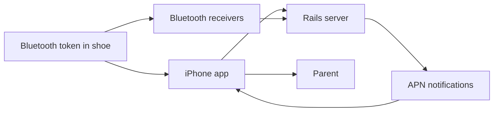
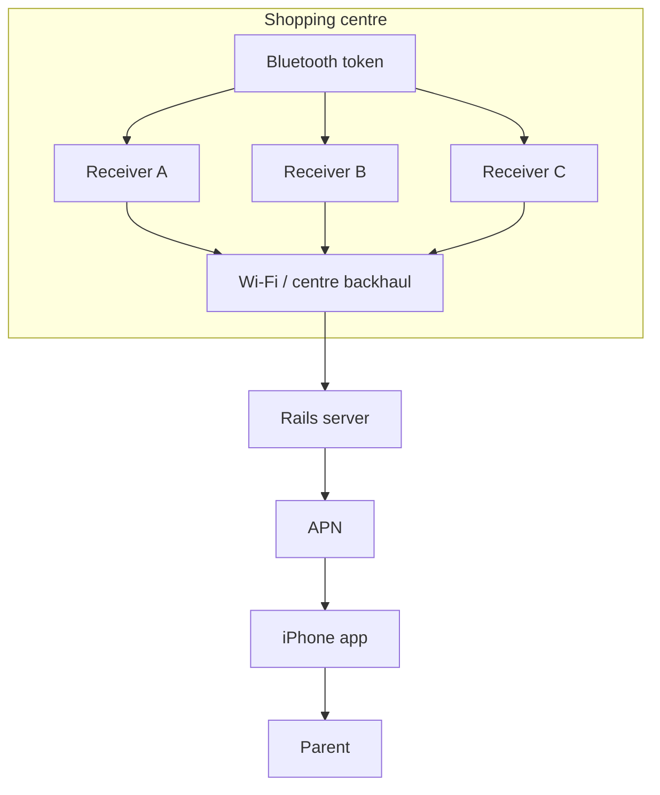

Before AirTag, before Find My accessories, and before Bluetooth Low Energy turned proximity into a mainstream product primitive, I worked on a child-tracking idea for shopping trips.

The pitch was simple enough to explain in one sentence. Put a small Bluetooth token into a pouch in a child's shoe, link it to an iPhone app, and let parents know where their child was if they wandered off in a shopping centre.

This was not only a sketch on a whiteboard. For the proof of concept, I repurposed pre-existing Bluetooth headphone chips to build rudimentary tracking devices and tested them with my own children while we were on holiday. That was enough to validate some basics about signal, handling, and the shape of the user experience, even if it was still far from a production-ready product.

We also had iPhone code, server code, scanning tools, and conversations with shopping centres about augmenting their Wi-Fi estate with Bluetooth receivers so the system would not depend only on nearby iPhones acting as repeaters. I was also accepted into Apple's MFi programme, which felt like a meaningful step forward at the time.

**The real lesson was that product viability was shaped less by code than by platform rules, hardware economics, and privacy risk.**

## What we actually built

Revisiting the code now is a useful reminder that this was a real prototype with real moving parts.

The iPhone side was Objective-C. It used Core Location, local Core Data models for children and tracking devices, and Apple Push Notification support. The server side was a Rails 2.3.5 application with endpoints for mobile devices, mobile locations, and notifications. There was also Bluetooth monitoring code on macOS, plus an older iPhone codebase that experimented with device discovery and peer communication.

In broad terms, the system looked like this:

The code still shows the structure clearly:

- the app modelled children as local records and linked them to tracking devices
- the app collected location updates and registered for push notifications
- the server stored mobile devices, location sightings, and notification tokens
- the monitor tools continuously scanned for Bluetooth devices
- the broader architecture allowed for both handset-based detection and fixed receiver infrastructure

None of that was especially elegant, but it was coherent. It was enough to prove there was a system here, not only an idea.

## How we proved the idea to ourselves

One reason I still find this project interesting is that we did not start with custom hardware. For the proof of concept, I used pre-existing Bluetooth headphone chips to assemble rudimentary tracking devices and tried them out with my own children while we were on holiday.

That sounds slightly improvised because it was. The point was not to prove manufacturability. It was to answer earlier questions more cheaply:

- could we detect something reliably enough to be useful?
- could a small token fit naturally into the routine?
- what would a parent-facing experience need to show?
- where did the idea break down in ordinary movement through public spaces?

That sort of test is often enough to separate an interesting architecture problem from a plausible product. In our case, it did both. It suggested there was something there technically, and it also pushed the commercial and privacy questions much closer to the front.

## What we thought the hard part would be

At the start, I would probably have said the hardest part was software integration.

Could the phone discover the token reliably enough? Could we keep location reasonably fresh? Could we push alerts quickly enough? Could the backend correlate a token, a child, a parent account, and a last known position?

Those were real questions, but they were not the decisive ones.

The iPhone app was old-fashioned, but workable. The Rails backend was hardly elegant, but it had the right primitives. The architecture even had a sensible next step: if handsets could not do enough on their own, fixed receivers in shopping centres could observe nearby tokens and send sightings back to our servers.

That venue-assisted version looked more like this:

That was an important change in shape. We were no longer relying purely on iPhones acting as repeaters. We were trying to use the shopping centre's own physical estate to improve coverage and reliability.

In product terms, that was the right instinct. It also exposed the real dependency more quickly.

## The real dependency was hardware economics

One of the main tenets of the idea was that the token had to be cheap enough to disappear into the retail flow. Not cheap in the vague sense that founders often promise to optimise later. Cheap in a way that changed what category of product this was.

Our target was under $5 per token.

That figure was not arbitrary. The proof-of-concept hardware was good enough to test the idea, but the intended product was never "ship modified headphone electronics". It was a cheap insertable token that could be bundled into children's shoes at retail scale.

That threshold shaped almost everything:

- it needed to be cheap enough to bundle with shoes
- cheap enough to lose without drama
- cheap enough to replace without a support saga
- cheap enough that a brand partner could treat it as an accessory, not a premium electronic device
- cheap enough that a parent would not handle it like something precious

**If the token could not be treated as near-disposable, the product premise started to collapse.**

This is where the MFi story became more interesting than the software. Getting accepted into Apple's MFi programme felt like progress, and it was. It reduced one kind of uncertainty. But it also made another constraint impossible to ignore.

The licensed Bluetooth encryption chips we needed were cost-prohibitive for the unit economics we were aiming at. Once the accessory path required hardware with that cost profile, the rest of the model stopped fitting together commercially.

This was not a matter of shaving a few points off a margin model. It changed the category of the thing we were building.

A sub-$5 insertable token can be treated almost like packaging. A materially more expensive device becomes a gadget. The retail conversation changes. The replacement conversation changes. The support conversation changes. Parent expectations change. The whole model shifts from "simple safety add-on" to "consumer electronics programme".

Software could not rescue that.

## Platform limits were broader than APIs

The cost problem was the decisive one, but it was not the only platform constraint.

This was a pre-BLE world. The modern assumptions people bring to proximity products did not hold. Background behaviour was more limited, scanning and discovery were clumsier, and some of the Bluetooth hooks available to us were not on the happy path for App Store software.

That showed up in the code too. Parts of the older iPhone work experimented with private Bluetooth frameworks. Other parts used GameKit peer discovery. The server handled device registration, location updates, and push notifications, but it all sat on top of an ecosystem that had not yet settled into a clean product layer for this kind of use case.

In other words, the platform was telling us something important: this was possible to prototype, but not yet natural to ship.

That distinction matters. Engineers can often build around a gap. Product teams cannot always build a business around one.

## The privacy problems were real, and easier to understate then than now

There is another part of this idea that deserves much more weight now than I would have given it at the time: privacy.

Tracking children in a retail environment raises hard questions even if the intent is plainly protective. In fact, clear intent can make teams too casual about the secondary risks.

The system implied a lot of sensitive joins:

- child identity
- parent identity
- token identity
- venue presence
- approximate or inferred location
- time history
- notification events

Even the holiday proof-of-concept testing brought that into focus. Testing with my own children kept the exercise bounded and practical, but it also made the ethical weight of the idea harder to ignore. A system like this does not stay in the realm of clever radio engineering for long. Very quickly it becomes a question of who can observe whom, under what conditions, for how long, and with what safeguards.

A venue-assisted version made those questions even sharper. If shopping centres hosted Bluetooth receivers and fed sightings to our servers, then the data boundary was no longer only between parent and app. It potentially involved operators, partners, retention rules, access controls, and future commercial pressure to reuse the data for things it was never meant to support.

The awkward truth is that you do not have to build a sinister system for it to become a risky one. A benign "help me find my child in this shopping centre" flow can drift into something else if the data lasts too long, can be queried too freely, or gets repurposed by venue operators, commercial partners, or a future product team with weaker instincts.

If I were approaching this problem now, I would put privacy architecture much earlier in the sequence:

- minimise identifiers from the start
- avoid collecting more history than the use case needs
- separate ephemeral safety events from long-lived account data
- make venue data boundaries explicit
- design for deletion, not only capture
- assume misuse cases will exist, not that good intentions prevent them

Back then, I saw privacy as an important design consideration. Now I would treat it as a first-order architecture constraint.

## What I took from revisiting the code

Looking back, I do not think the prototype failed because we lacked technical imagination. If anything, we had plenty. We had an app, a server, scanning tools, an MFi path, working proof-of-concept hardware, and discussions with shopping centres about supplementing Wi-Fi with Bluetooth receivers.

What we did not have was a fit between product premise and platform reality.

The premise required:

- phone platform support that was good enough
- accessory rules that were commercially survivable
- hardware cheap enough to be almost disposable
- partner infrastructure that shopping centres would actually deploy
- privacy posture strong enough for a sensitive use case

Any one of those could have caused trouble. Together, they defined the outcome more than the quality of any individual Objective-C class or Rails controller.

That is what makes the code interesting to me now. It is not evidence that we were one sprint away from an early AirTag. It is evidence that **you can be directionally right about a product and still be years too early on the surrounding ecosystem**.

## The general lesson

**When a product depends on platform-controlled hardware, the real architecture includes licensing, unit economics, partner incentives, and privacy boundaries, not only APIs and servers.** We could make the software plausible. What we could not do was make the whole system fit the commercial and ethical constraints that actually mattered.
