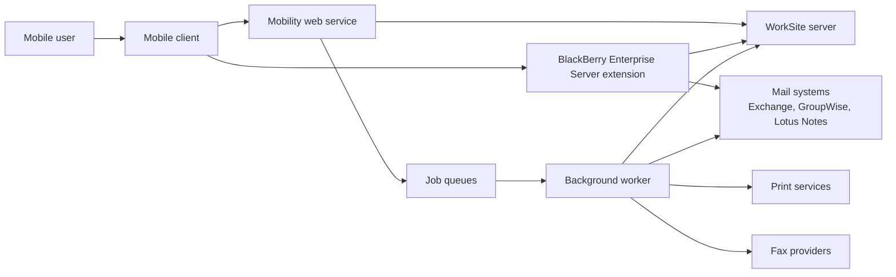
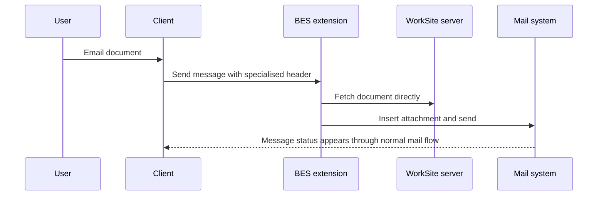

When people hear "enterprise mobility" now, they tend to picture responsive web apps, iPhones, push notifications and cloud APIs. That is not the world we were building for.

The mobility product I sold to Interwoven was aimed at WorkSite users who needed documents and email workflows away from their desks. The client side mattered, but the older I get the less I think the handset was the clever bit. The hard part was making awkward enterprise systems behave well enough, and predictably enough, that a mobile user could trust them.

This post covers what that product taught me, and why **mobile software often succeeds or fails on the server-side seams that users never see**.

## The device was the visible part, not the difficult part

The visible feature list sounded straightforward. Browse folders. Search for documents. Manage matters and workspaces. View profiles. Open or download files. Email, print or fax a document. File a message back into WorkSite.

On the device, those capabilities showed up as menus, forms, lists and document views. In that era, that often meant BlackBerry clients and small, constrained screens. Everything had to be explicit. You could not assume a wide display, rich browser support or a patient network connection.

It was not a document viewer with a few shortcuts bolted on. The client and server together supported proper matter and workspace workflows, including viewing documents and filing email back to the right place in WorkSite. In legal environments, it was not enough to move content around. The system had to preserve where correspondence belonged.

Those constraints forced discipline. You kept flows short, avoided unnecessary round trips, and decided quickly which operations should feel immediate and which should become background work.

Data costs mattered as well. If a device downloaded a document over the air and then sent that same document back out as an email attachment, the user had effectively paid for the transfer twice. That changed the design.

That is also why wire encryption and compression mattered so much. Encryption protected sensitive legal documents and correspondence. Compression improved speed on poor links and cut data usage at the same time. Security, performance and cost reduction were all bound up together.

The difficult part sat behind the client. Every simple user action crossed at least one boundary into a system we did not control.

## Every feature was really an integration problem

A user saw a button labelled email or file. We saw a chain of dependencies.

To make that button work, we had to bridge a mobile client, the WorkSite server, mail systems such as Exchange, GroupWise and Lotus Notes, rendering services, print services, fax providers and a set of Windows processes that could run unattended for long periods. Each system had its own API style, its own failure modes and its own operational habits.

The real unit of work was often not a file but a matter or workspace context. A useful mobile workflow had to preserve where a document came from, where a message should be filed, and how a piece of correspondence related to a case. That is why legal mobility was harder than generic mobile content access.

That changes how you think about product design. The question stops being "can we add this feature?" and becomes "which systems need to co-operate, what can fail, and where do we recover?"

That is why I still like provider-style architectures for integration-heavy products. We hid vendor-specific detail behind internal abstractions because enterprise products live longer than any one SDK. If you tie the whole product directly to a mail API, a content API or a fax API, every external change becomes an internal rewrite.

That lesson has aged well. Today it might be SaaS APIs, webhooks and OAuth scopes instead of COM objects and Windows services, but the design pressure is the same.

A simple way to picture the product is as a small client sitting in front of a large integration surface:

## Asynchronous work was product design, not plumbing

The biggest architectural shift was realising that many actions should not be synchronous at all.

If someone wants to send a document by email, file a message into WorkSite, or route a document to print or fax, there is little value in making the handset wait for every back-end step to complete. What the user needs is confidence that the request was accepted, that it is progressing, and that failure will be visible rather than silent.

One of the clearest examples was document email from the BlackBerry client. Doing it naively would have meant downloading the document to the handset and then sending it back out again as an attachment, which doubled the mobile data cost. To avoid that, I extended BlackBerry Enterprise Server so it could connect directly to WorkSite. The client inserted a specialised mail header, and the server-side integration used that to fetch and attach the document without sending the binary over the mobile network twice.

That was not only about cost. The integration was aimed at legal correspondence, where messages needed to stay tied to the right matter or case. Server-side handling gave us a better path to accurate filing and more dependable correspondence records than a purely device-led workflow.

| | Device-led email | BES and WorkSite email |
|---|---|---|
| Document transfer | Download to handset, then send again | Fetch once server-side |
| Mobile data cost | Paid twice | Paid once |
| Filing context | Easier to lose | Matter or workspace context preserved |
| Operational control | Lives on device | Lives on managed server path |

So we leaned on queued work. That gave us room for retries, logging, status reporting and cleanup policies. It also let the front end stay small. A mobile client could submit intent and poll for outcome, rather than carrying the complexity of every downstream operation.

A document email flow looked more like this than like a direct handset-to-mail-server call:

This mattered more than any client-side flourish. A slightly plain interface is forgivable. A button that sometimes works, sometimes hangs and sometimes loses work is not.

I still see teams treat queues as implementation detail. In systems like this, they are part of the user experience. **Reliability is a feature, even when it looks like background plumbing.**

## Internal tools tell the truth about a product

Years later, one of the most interesting things in the old repositories is not the main application code. It is the test harnesses, crash tools, Exchange diagnostics and helper utilities around it.

Those tools show what the team actually struggled with: which failures were common enough to deserve their own utility, which dependencies were awkward enough to need a reproduction app, and which administrative tasks were painful enough to automate.

I have become much more respectful of that kind of code over time. In integration-heavy products, internal tools are often where operational knowledge becomes durable. If a system needs bespoke tools to observe it, debug it or recover it, that is not necessarily a sign of poor engineering. Sometimes it is a sign that the team understood the real work well enough to support it.

## What I would carry forward now

If I were building the same kind of product today, the stack would be different. The architectural instincts would not.

I would still keep the client thin. I would still isolate external systems behind adapters and push long-running work into queues with explicit status. I would also spend even more time on observability, because complex integrations fail in ways that only become obvious once the product is in production.

What I would be less likely to do now is believe that a polished demo proves the hard part is done. In enterprise software, demos reward the visible path. Production rewards the recovery path.

## The general lesson

When software sits between several other systems, the user interface is only the tip of the problem. **The real product is the set of boundaries you make dependable.** If the seams are clear, the background work is resilient and the customisation points are deliberate, the front end can stay simple. If those things are weak, no amount of mobile polish will save it.
